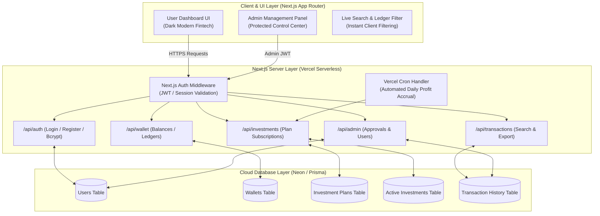
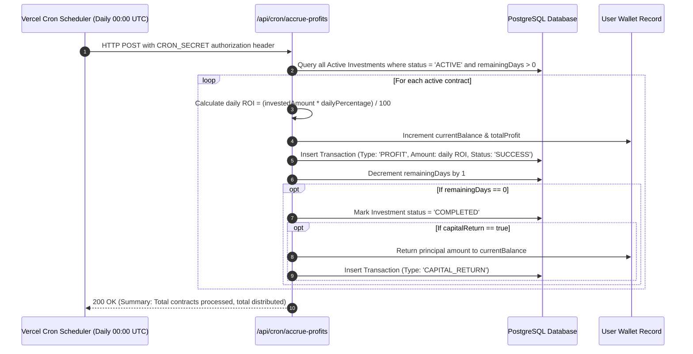
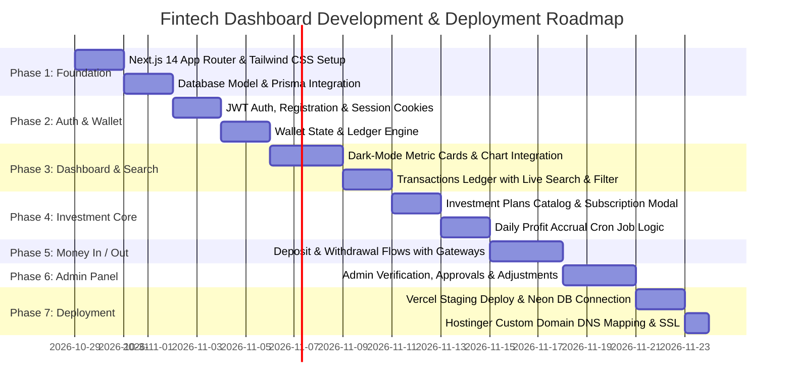

# Product Requirements Document (PRD)
## Next.js Full-Stack Fintech & Investment Dashboard Platform

---

## 1. Executive Summary & Project Overview

### 1.1 Objective
To develop a high-performance, secure, responsive **Full-Stack Fintech & Investment Dashboard Platform** inspired by modern investment portals (such as WBI Finance and FinixoBrain), engineered from the ground up using **Next.js (App Router)**, **Tailwind CSS**, and **PostgreSQL (Prisma ORM)**.

### 1.2 Deployment Target
* **Staging / Production Compute:** **Vercel** (Global Serverless / Edge deployment with automatic SSL and zero server maintenance).
* **Domain Integration:** **Hostinger DNS** routed via A/CNAME records to Vercel.
* **Database:** **Neon Serverless PostgreSQL** or **Supabase** (Free-tier, cloud-native connection pooling).

---

## 2. High-Level Architecture & Data Flow



---

## 3. UI/UX Design System & Visual Wireframes

### 3.1 Design Tokens & Aesthetic Standards
* **Color Palette:**
  * **Background Base:** `#0B0F19` (Deep Obsidian Dark)
  * **Card Surface:** `#111827` (Navy Slate) with border `rgba(255, 255, 255, 0.08)`
  * **Primary Accent:** `#10B981` (Emerald Green - Positive returns & CTA buttons)
  * **Secondary Accent:** `#06B6D4` (Cyan Blue - Charts & Badges)
  * **Warning / Pending:** `#F59E0B` (Amber Gold)
  * **Danger / Reject:** `#EF4444` (Coral Red)
  * **Text Primary:** `#F9FAFB` (Crisp Off-white)
  * **Text Muted:** `#9CA3AF` (Cool Grey)
* **Glassmorphism:** `backdrop-blur-md bg-opacity-70 border border-white/10 shadow-2xl`
* **Typography:** Inter or Outfit, clean geometric sans-serif.

---

### 3.2 Visual UI Wireframe: User Dashboard Overview

```text
+----------------------------------------------------------------------------------------------------+
|  [LOGO] FINTECH PULSE        [Overview]  [Plans]  [Deposit]  [Withdraw]  [Referrals]    (User Avatar)  |
+----------------------------------------------------------------------------------------------------+
|                                                                                                    |
|   WELCOME BACK, ALEX STEWART!                                              [+ Quick Deposit]       |
|   Account ID: #FP-98231 | Status: Verified Active                      [  Withdraw Funds ]       |
|                                                                                                    |
|   +-------------------+  +-------------------+  +-------------------+  +-------------------+       |
|   | TOTAL WALLET BAL  |  | ACTIVE INVESTED   |  | TOTAL EARNED ROI  |  | PENDING WITHDRAW  |       |
|   | $ 24,580.45       |  | $ 18,000.00       |  | $  6,580.45       |  | $    750.00       |       |
|   | +14.2% this month |  | 3 Active Contracts|  | Next Payout in 6h |  | 1 Request In-Rev  |       |
|   +-------------------+  +-------------------+  +-------------------+  +-------------------+       |
|                                                                                                    |
|   +------------------------------------------------------------------+  +--------------------------+
|   | PORTFOLIO GROWTH ANALYTICS (Interactive Chart)                   |  | QUICK ACTION WALLET      |
|   | [1W] [1M] [3M] [1Y] [ALL]                                        |  | Deposit Address (TRC20): |
|   |                                                                  |  | [ T9yB...4xK9 ] [Copy]   |
|   |   $25k |                         .---* (Current: $24,580)        |  |                          |
|   |   $20k |                 .------/                                |  | Daily Interest Rate:     |
|   |   $15k |         .------/                                        |  | 2.5% Avg Daily Return    |
|   |   $10k | *------/                                                |  |                          |
|   |        +-------------------------------------------------------  |  | [ Explore All Plans -> ] |
|   |          Oct 1     Oct 8     Oct 15    Oct 22    Oct 28          |  |                          |
|   +------------------------------------------------------------------+  +--------------------------+
|                                                                                                    |
|   RECENT ACTIVITY & TRANSACTIONS                                                                   |
|   [ Search by TxID, Amount, or Note...                 ]  [ Filter: All v ]  [ Export CSV ]        |
|   +-----------------+---------------+----------------+----------------+-------------+------------+ |
|   | DATE & TIME     | TYPE          | AMOUNT         | METHOD         | TX HASH     | STATUS     | |
|   +-----------------+---------------+----------------+----------------+-------------+------------+ |
|   | 2026-10-28 12:15| Daily Profit  | +$125.00       | Automated ROI  | TX-7892104  | [Success]  | |
|   | 2026-10-27 18:30| Deposit       | +$2,000.00     | USDT (TRC20)   | 0x8a9f...c2 | [Approved] | |
|   | 2026-10-26 09:40| Withdrawal    | -$750.00       | BTC Wallet     | TX-3409112  | [Pending]  | |
|   | 2026-10-25 14:00| New Invest    | -$5,000.00     | Ultra Plan Tier| INV-990145  | [Active]   | |
|   +-----------------+---------------+----------------+----------------+-------------+------------+ |
+----------------------------------------------------------------------------------------------------+
```

---

### 3.3 Visual UI Wireframe: Investment Plans Grid & Modal

```text
+----------------------------------------------------------------------------------------------------+
|  EXPLORE INVESTMENT TIERS                                                                          |
|  Select a tier that matches your investment horizon. Profits credited automatically every 24 hours.|
|                                                                                                    |
|  +------------------------+  +------------------------+  +------------------------+                |
|  | STARTER TIER           |  | PREMIUM GROWTH (Hot)   |  | VIP CAPITAL PARTNER    |                |
|  | 1.5% Daily for 15 Days |  | 2.8% Daily for 30 Days |  | 4.0% Daily for 60 Days |                |
|  +------------------------+  +------------------------+  +------------------------+                |
|  | Min: $100              |  | Min: $1,000            |  | Min: $10,000           |                |
|  | Max: $999              |  | Max: $9,999            |  | Max: $100,000          |                |
|  | Total Return: 122.5%   |  | Total Return: 184.0%   |  | Total Return: 340.0%   |                |
|  | Capital Return: YES    |  | Capital Return: YES    |  | Capital Return: YES    |                |
|  | Payout: Daily at 00:00 |  | Payout: Daily at 00:00 |  | Payout: Daily at 00:00 |                |
|  +------------------------+  +------------------------+  +------------------------+                |
|  |   [ Invest in Starter] |  |   [ Invest in Premium] |  |   [ Invest in VIP ]    |                |
|  +------------------------+  +------------------------+  +------------------------+                |
+----------------------------------------------------------------------------------------------------+
                                 |
                                 v [Modal Opens When Clicked]
        +--------------------------------------------------------------------+
        |  CONFIRM INVESTMENT: PREMIUM GROWTH TIER                           |
        |  Wallet Available Balance: $24,580.45                              |
        |                                                                    |
        |  Enter Investment Amount ($):                                      |
        |  [ $ 5,000.00                                                    ] |
        |                                                                    |
        |  Summary Breakdown:                                                |
        |  * Daily Profit: $140.00 (2.8%)                                    |
        |  * Duration: 30 Days                                               |
        |  * Net Estimated Profit: $4,200.00                                 |
        |  * Total Payout with Principal: $9,200.00                          |
        |                                                                    |
        |  [ Cancel ]                                  [ Confirm & Lock-In ] |
        +--------------------------------------------------------------------+
```

---

### 3.4 Visual UI Wireframe: Admin Management Center

```text
+----------------------------------------------------------------------------------------------------+
|  [ADMIN PORTAL] SYSTEM MANAGEMENT                      [Dashboard] [Users] [Deposits] [Withdrawals]|
+----------------------------------------------------------------------------------------------------+
|                                                                                                    |
|  PENDING DEPOSIT & WITHDRAWAL REQUESTS                                                             |
|  Real-time verification queue for admin approval.                                                 |
|                                                                                                    |
|  +------------+---------------+----------+------------+----------------------+-------------------+ |
|  | USER       | REQ TYPE      | AMOUNT   | METHOD     | PROOF / DESTINATION  | ACTION            | |
|  +------------+---------------+----------+------------+----------------------+-------------------+ |
|  | John Doe   | Deposit       | $1,500   | USDT TRC20 | View Proof Image.png | [Approve] [Reject]| |
|  | Sarah K.   | Withdrawal    | $750     | BTC        | bc1q9k4x0m...p8      | [Approve] [Reject]| |
|  | Mike R.    | Deposit       | $5,000   | Bank Wire  | WireReceipt_98.pdf   | [Approve] [Reject]| |
|  +------------+---------------+----------+------------+----------------------+-------------------+ |
|                                                                                                    |
|  USER BALANCE ADJUSTMENT TOOL                                                                      |
|  Select User: [ alex@example.com (Alex Stewart)      v ]                                           |
|  Adjustment Type: [ Credit (+) v ]     Amount ($): [ 500.00 ]                                      |
|  Reason / Reference: [ Promotional Bonus or Correction                              ]              |
|  [ Execute Balance Update ]                                                                        |
+----------------------------------------------------------------------------------------------------+
```

---

## 4. Backend System Architecture & API Handlers

### 4.1 Core API Routes (Next.js Route Handlers)

| Endpoint | Method | Role | Description |
| :--- | :--- | :--- | :--- |
| `/api/auth/register` | `POST` | Public | Creates new user, generates referral code, hashes password with Bcrypt |
| `/api/auth/login` | `POST` | Public | Validates credentials, sets secure HTTP-Only JWT session cookie |
| `/api/auth/logout` | `POST` | Authenticated | Clears auth session cookie |
| `/api/wallet/overview` | `GET` | Authenticated | Returns wallet balance, active investments, and profit aggregates |
| `/api/investments/plans`| `GET` | Authenticated | Retrieves all available investment tiers |
| `/api/investments/subscribe`| `POST` | Authenticated | Validates balance, creates active investment, deducts principal |
| `/api/transactions` | `GET` | Authenticated | Returns paginated transactions with server-side query search & filter |
| `/api/transactions/deposit`| `POST` | Authenticated | Creates a pending deposit request with gateway/proof upload metadata |
| `/api/transactions/withdraw`| `POST`| Authenticated | Validates withdrawal limits and creates pending withdrawal record |
| `/api/cron/accrue-profits` | `POST` | Vercel Cron | Automated scheduled worker that calculates and distributes daily ROI |
| `/api/admin/requests` | `GET/POST`| Admin Only | Approves or rejects pending deposits/withdrawals with ledger updates |
| `/api/admin/users/adjust` | `POST` | Admin Only | Credits or debits user balance with mandatory audit logging |

---

### 4.2 Automated Profit Accrual Logic (Cron Model)



---

## 5. Database Schema (Prisma Specification)

```prisma
datasource db {
  provider = "postgresql"
  url      = env("DATABASE_URL")
}

generator client {
  provider = "prisma-client-js"
}

enum Role {
  USER
  ADMIN
}

enum TransactionType {
  DEPOSIT
  WITHDRAWAL
  INVESTMENT
  PROFIT
  CAPITAL_RETURN
  REFERRAL_BONUS
}

enum Status {
  PENDING
  APPROVED
  REJECTED
  ACTIVE
  COMPLETED
}

model User {
  id              String        @id @default(cuid())
  email           String        @unique
  name            String
  passwordHash    String
  role            Role          @default(USER)
  referralCode    String        @unique
  referredBy      String?
  wallet          Wallet?
  investments     Investment[]
  transactions    Transaction[]
  createdAt       DateTime      @default(now())
  updatedAt       DateTime      @updatedAt
}

model Wallet {
  id              String        @id @default(cuid())
  userId          String        @unique
  user            User          @relation(fields: [userId], references: [id], onDelete: Cascade)
  currentBalance  Decimal       @default(0.00) @db.Decimal(14, 2)
  totalInvested   Decimal       @default(0.00) @db.Decimal(14, 2)
  totalProfit     Decimal       @default(0.00) @db.Decimal(14, 2)
  totalDeposited  Decimal       @default(0.00) @db.Decimal(14, 2)
  totalWithdrawn  Decimal       @default(0.00) @db.Decimal(14, 2)
  updatedAt       DateTime      @updatedAt
}

model InvestmentPlan {
  id              String        @id @default(cuid())
  name            String        // e.g. "Starter", "Premium Growth", "VIP"
  minAmount       Decimal       @db.Decimal(14, 2)
  maxAmount       Decimal       @db.Decimal(14, 2)
  dailyPercentage Decimal       @db.Decimal(5, 2)  // e.g. 2.50%
  durationDays    Int           // e.g. 30 days
  capitalBack     Boolean       @default(true)
  isActive        Boolean       @default(true)
  investments     Investment[]
}

model Investment {
  id              String          @id @default(cuid())
  userId          String
  user            User            @relation(fields: [userId], references: [id])
  planId          String
  plan            InvestmentPlan  @relation(fields: [planId], references: [id])
  investedAmount  Decimal         @db.Decimal(14, 2)
  dailyPercentage Decimal         @db.Decimal(5, 2)
  durationDays    Int
  remainingDays   Int
  status          Status          @default(ACTIVE)
  createdAt       DateTime        @default(now())
}

model Transaction {
  id              String          @id @default(cuid())
  userId          String
  user            User            @relation(fields: [userId], references: [id])
  type            TransactionType
  amount          Decimal         @db.Decimal(14, 2)
  fee             Decimal         @default(0.00) @db.Decimal(14, 2)
  status          Status          @default(PENDING)
  method          String          // "USDT_TRC20", "BTC", "BANK_WIRE", "INTERNAL"
  txHash          String?
  proofUrl        String?
  note            String?
  createdAt       DateTime        @default(now())
}
```

---

## 6. Execution Roadmap & Development Phases



### Phase Details:
* **Phase 1: Project Foundation & Database Setup**
  * Initialize Next.js with TypeScript, Tailwind CSS, and Lucide Icons.
  * Configure Prisma schema and link with Neon PostgreSQL database.
* **Phase 2: Authentication & Wallet Engine**
  * Secure Signup/Login with Bcrypt hashing and HTTP-Only JWT tokens.
  * Automated creation of user wallet on registration.
* **Phase 3: User Dashboard & Instant Search Engine**
  * Modern Dark UI with glassmorphism metric cards and portfolio growth chart.
  * Real-time search and filter bar for transaction history (by TxID, Type, or Status).
* **Phase 4: Investment Engine & Automated Profit Accrual**
  * Dynamic plan cards with real-time ROI calculator.
  * Investment subscription modal and Vercel Cron `/api/cron/accrue-profits`.
* **Phase 5: Deposit & Withdrawal Workflows**
  * Crypto deposit simulation (address generation, QR, proof submission).
  * Withdrawal request flow with balance validation and safety checks.
* **Phase 6: Admin Control Center**
  * Dedicated admin route `/admin` with role guard.
  * Pending requests table with one-click Approve/Reject buttons.
  * Manual balance credit/debit tool with full audit logging.
* **Phase 7: Production Deployment & Hostinger DNS Configuration**
  * Push to GitHub repository and connect to Vercel.
  * Set environment variables in Vercel (`DATABASE_URL`, `JWT_SECRET`, `CRON_SECRET`).
  * In Hostinger hPanel DNS Zone:
    * Add `A Record`: Host `@` -> Points to `76.76.21.21` (Vercel IP).
    * Add `CNAME Record`: Host `www` -> Points to `cname.vercel-dns.com`.
  * Verify automated SSL issuance and test full end-to-end user journeys.

---

## 7. Security & Anti-Exploitation Measures
1. **Server-Side Authorization:** Every mutation (`subscribe`, `withdraw`, `admin actions`) validates the session server-side; client manipulation is impossible.
2. **Atomic Balance Updates:** Database balance transactions use row-locking / atomic Prisma increments to prevent double-spending.
3. **Password Security:** Password hashing utilizing standard Bcrypt with 12 salt rounds.
4. **Environment Isolation:** Zero credentials in client-side code; sensitive configurations stored exclusively in `.env` and Vercel Encrypted Environment Settings.
